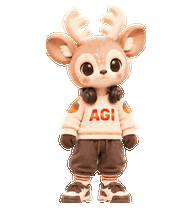
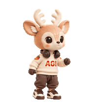
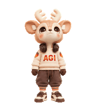
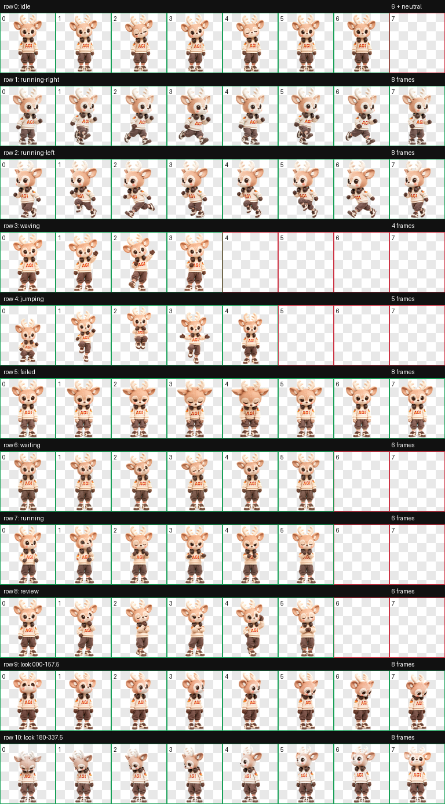

## 关于 WaytoAGI 社区

**WaytoAGI（通往 AGI 之路）** 是面向 AI 学习者、创作者与实践者的开放知识库和共学社区，连接 AI 知识、真实实践与城市共学，希望让更多人少走弯路，因 AI 而强大。

社区从持续开放的 AI 知识库出发，整理学习路径、工具、教程和实践案例，并通过晚间共学、城市活动、AI 切磋大会及共创项目，把学习连接到真实作品与实践。知识库内容免费公开，参与者也可以分享经验、贡献内容或参加活动。

- [官网与开放知识库](https://www.waytoagi.com/)
- [关于 WaytoAGI](https://about.waytoagi.com/)
- [加入社区与活动入口](https://events.waytoagi.com/)
- 微信公众号：**通往AGI之路**

以上为社区官方公开资料的简要整理，核对日期：2026 年 11 月 22 日；活动与参与方式以官方页面为准。本仓库是个人制作并分享的 Codex 桌宠，社区介绍不代表官方发布或授权声明。

# WaytoAGI小鹿 · Codex 桌面宠物

戴着耳机、穿着 AGI 卫衣的毛绒小鹿，陪你写代码、等输入、看结果。包含 **9 组基础动作、16 个朝向**，可直接安装到支持自定义 V2 宠物的 Codex 桌面版。

<p align="center">
  
  
  
</p>

## 安装

1. 在 [Releases](https://github.com/yeyoushen-03/codex-waytoagi-deer-pet/releases/latest) 下载 `waytoagi-deer-codex-v2.zip`，解压得到 `agi-deer` 文件夹。
2. 将该文件夹放到 Codex 数据目录中的 `pets/` 下。默认路径：

   | 系统 | 安装后的配置文件 |
   | --- | --- |
   | macOS / Linux | `~/.codex/pets/agi-deer/pet.json` |
   | Windows | `%USERPROFILE%\.codex\pets\agi-deer\pet.json` |

   如果设置了 `CODEX_HOME`，则使用该目录下的 `pets/agi-deer/`。文件夹中必须同时有 `pet.json` 和 `spritesheet.webp`，不要再多嵌套一层。

3. 在 Codex 宠物列表中选择 **WaytoAGI小鹿**。如果尚未显示，重新打开列表或重启 Codex。仅支持能加载 V2 自定义宠物的客户端。

也可克隆后复制这两个文件（macOS / Linux）：

```sh
git clone https://github.com/yeyoushen-03/codex-waytoagi-deer-pet.git
mkdir -p "${CODEX_HOME:-$HOME/.codex}/pets/agi-deer"
cp codex-waytoagi-deer-pet/pet.json codex-waytoagi-deer-pet/spritesheet.webp   "${CODEX_HOME:-$HOME/.codex}/pets/agi-deer/"
```

## 动作与朝向

| 动作 / 状态 | 内容表现 | 对应使用场景 | 帧数 |
| --- | --- | --- | ---: |
| 待机 `idle` | 轻微呼吸、自然眨眼，安静陪伴 | 当前没有任务，或处于空闲状态 | 6 |
| 向右移动 `running-right` | 向右迈步，耳机与衣服保持稳定 | 桌宠在屏幕上向右移动 | 8 |
| 向左移动 `running-left` | 向左迈步，AGI 字样保持正向 | 桌宠在屏幕上向左移动 | 8 |
| 挥手 `waving` | 抬手挥动，向用户打招呼 | 问候或互动反馈 | 4 |
| 跳跃 `jumping` | 蹲下蓄力、腾空、落地 | 活跃互动或开心反馈 | 5 |
| 失败 `failed` | 低头、垂眼，随后恢复 | 任务失败或出现错误时的情绪反馈 | 8 |
| 等待输入 `waiting` | 期待地望向用户，等待回应 | 需要用户补充信息、回答问题或确认 | 6 |
| 工作中 `running` | 专注思考，保持忙碌状态 | Codex 正在处理请求或执行任务 | 6 |
| 审查 `review` | 托腮、倾头，仔细检查 | 检查结果、审阅代码等需要专注的状态 | 6 |
| 环顾 `look` | 通过眼球、眼睑和头颈变化朝向目标 | 按光标或目标位置选择对应朝向 | 16 个方向 |

表中“对应使用场景”用于说明素材语义。实际触发时机和状态切换由 Codex 客户端或接入方决定；安装包提供图像与宠物配置。基础动作之外另有一个默认正面姿势。

此外提供 16 个顺时针朝向和一个默认正面姿势。`000°` 为上，`090°` 为屏幕右，`180°` 为下，`270°` 为屏幕左。

[查看全部动作预览](assets/previews/) · [查看 16 个朝向](assets/look-directions.png)



## 文件规格与验收

- `spriteVersionNumber: 2`。
- 透明 WebP，**1536×2288**；8 列 × 11 行，每格 192×208。
- 基础动作 57 帧，朝向 16 格，默认正面 1 格，共 74 个占用单元。
- 已通过 V2 尺寸、透明背景、边缘与单元校验，三位独立审查的方向盲测，以及最终视觉检查。
- 部分斜向提示较轻，个别相邻转头幅度略不均；四个正方向明确，没有方向反转或明显比例跳变。

验收记录见 [docs/qa](docs/qa/)。图像以用户提供的角色参考为基础，由 AI 辅助生成并整理为精灵图。保留鹿角、耳机、服装、材质和正向 AGI 字样。

## 许可证

项目使用 [MIT License](LICENSE)。使用或分发时保留许可证。项目由社区制作，与 OpenAI 无隶属或官方背书关系。

## 作者

作者：[yeyoushen-03](https://github.com/yeyoushen-03)
